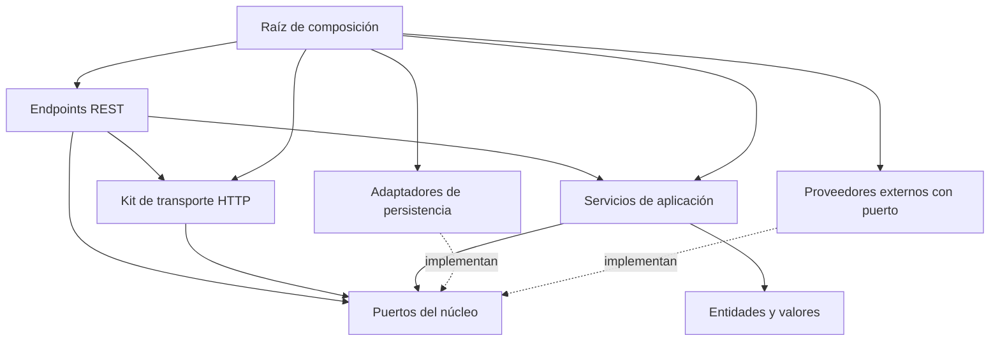

## 1. Estructura y Responsabilidades

El servicio sigue una arquitectura hexagonal: el núcleo (`domain`, `application`) define y usa contratos, la infraestructura los implementa o los expone, y `src/app.rs` es el único lugar que conoce las piezas concretas para conectarlas. Por eso, dónde pertenece un cambio depende de qué frontera cruza.

- Mantendré la arquitectura en `src/domain/`, `src/application/`, `src/infrastructure/` y `src/shared/`; no introduciré un `src/core/` paralelo ni copiaré el aislamiento por slices de otros proyectos.
- Consultaré `PROJECT.md` antes de añadir reglas de negocio. Si está vacío o la política requerida no existe, la acordaré con el usuario antes de implementarla; no convertiré las decisiones de las entidades `Demo*` en reglas de producción.
- Crearé entidades, puertos, repositorios, modelos y DTOs solo cuando la capacidad los necesite. Un flujo compuesto sin agregado propio reutilizará puertos o servicios y no recibirá persistencia ficticia. Usaré servicios de dominio únicamente para lógica pura que no corresponda a una entidad, y no crearé carpetas vacías como scaffolding.
- Registraré una capacidad en los módulos de su capa, la construiré en `src/app.rs` y la montaré en `rest/mod.rs` si expone HTTP. No añadiré campos ni macros a un `AppState` global por recurso.

| Ruta o patrón                                                          | Responsabilidad                                                                                                                                         | Límites e integración                                                                                                            |
| ---------------------------------------------------------------------- | ------------------------------------------------------------------------------------------------------------------------------------------------------- | -------------------------------------------------------------------------------------------------------------------------------- |
| `src/main.rs`                                                          | Reuniré en `bootstrap()` `envs::init()`, los proveedores criptográficos y tracing; después ejecutaré `app::run()` y cerraré la telemetría.               | Ante un fallo devolveré `ExitCode::FAILURE`; antes de existir tracing solo informaré por stderr.                                 |
| `src/app.rs`                                                           | Construiré en `run`, de arriba abajo, recursos → repositorios → servicios → routers → `ServerOptions`/`ServerLauncher`.                                  | Leeré `envs::get()` y entregaré valores por constructor; no trasladaré aquí validaciones ni decisiones de negocio.                |
| `src/domain/core/{context,error,identity,pagination,values}.rs`        | Definiré contexto de operación, errores, IDs tipados, identidad y paginación reutilizables.                                                             | No dependeré de entidades ni puertos de negocio; no alojaré drivers, configuración, DTOs ni utilidades de logging.               |
| `src/domain/entities/<entity>.rs`                                      | Modelaré el agregado, sus tipos específicos y su ID tipado.                                                                                             | Sin drivers ni framework web.                                                                                                    |
| `src/domain/port/<capability>.rs`                                      | Declararé el contrato que consume el núcleo y sus tipos neutros (p. ej. `TaskRequest`, `Enqueued` en `task_queue.rs`).                                   | No obligaré a un CRUD completo ni mencionaré SDKs, buckets, OIDC o cabeceras.                                                    |
| `src/application/<capability>.rs`                                      | Coordinaré dominio y puertos; recibiré dependencias explícitas por constructor.                                                                        | Mantendré juntos los métodos cohesionados y dividiré el archivo por responsabilidades, no por un número arbitrario de líneas.     |
| `src/infrastructure/persistence/mongo/<entity>/{model,repository}.rs` | Convertiré representaciones y ejecutaré consultas; `Repository::new` garantizará sus índices.                                                          | Recibiré `&Database` desde `app.rs`, sin importar `providers`.                                                                   |
| `src/infrastructure/providers/`                                        | Prepararé recursos externos: `mongo.rs` (`connect`), `redis.rs`, `gcp/{gcs,gct}.rs` y `auth/`.                                                          | Sin entidades ni documentos; las reglas de activación están en 3.6.                                                              |
| `src/infrastructure/http/`                                             | Mantendré el kit de transporte Axum: servidor, middlewares, extractores, autenticación HTTP, permisos, paginación, sondas, errores y respuesta.          | No conocerá `application` ni los endpoints; `ServerLauncher` no dependerá de rutas de negocio ni de un estado global de servicios. |
| `src/infrastructure/rest/mod.rs`                                       | Compondré el router de la API, relativo a su prefijo, montando cada recurso con `.nest`.                                                                | Recibiré los servicios concretos; `app.rs` monta la autenticación alrededor.                                                     |
| `src/infrastructure/rest/<resource>/`                                  | Expondré los endpoints de un recurso (anatomía abajo).                                                                                                  | No moveré al kit nada que dependa de servicios o DTOs.                                                                           |
| `src/shared/`                                                          | Mantendré configuración (`envs.rs`), construcción del cliente HTTP (`http_client.rs`) y telemetría (`tracer.rs`).                                       | No alojaré entidades, catálogos de permisos comerciales ni lógica de negocio.                                                    |

Cada recurso REST sigue la misma anatomía, incluido `me`:

```text
src/infrastructure/rest/<resource>/
├── mod.rs        # `pub fn router(service: Arc<Service>) -> Router`: rutas relativas, permisos por método si hay autenticación, y `with_state`
├── handlers.rs   # Handlers `pub(super)`: extraen, invocan el servicio y construyen la respuesta, sin reglas de negocio
└── dtos.rs       # `*Input`/`*Output` y sus mapeos, exclusivos del transporte
```

El kit `http/` arranca el servidor desde `http/mod.rs` y expone ahí, mediante `pub use`, toda su superficie pública; sus módulos internos son privados para que `rest/` y `app.rs` no dependan de su organización:

```text
src/infrastructure/http/
├── mod.rs          # Arranque (ServerOptions, ServerLauncher, capas, bind, señales, drenado, fallbacks 404/405) y fachada pública
├── health.rs       # Único módulo público: health::router(ready) con /healthz y /readyz, y el estado de drenado
├── format.rs       # JSON/MessagePack: BodyFormat, Content-Type de entrada, negociación por Accept, codificación
├── context.rs      # Extractor de Context y ContextRequestExt para middlewares
├── error.rs        # ApiError y HttpRejection; registro de errores HTTP
├── response.rs     # ApiResponse, Paginated y paginated()
├── request/        # mod.rs con PaginationQuery; body.rs, path.rs y query.rs (ValidatedBody, PathParam, ValidatedQuery)
├── middleware.rs   # Timeout y validación de Content-Encoding; declara middleware/trace.rs
└── auth/           # mod.rs con el extractor de AuthPrincipal; middleware.rs y permissions.rs
```

- Reexportaré en `mod.rs` solo lo que consumen `rest/` y `app.rs`: `ApiError`, `ApiResponse`, `Paginated`, `paginated`, `ValidatedBody`, `ValidatedQuery`, `PathParam`, `PaginationQuery`, `RequirePermissionExt`, `Policy`, `auth_middleware`, `ContextRequestExt`, `ServerLauncher` y `ServerOptions`. `HttpRejection`, `BodyFormat`, el task-local de formato y los middlewares no saldrán del kit.
- Mantendré en `format.rs` todo lo que dependa del formato de cable; `request/body.rs` y `response.rs` lo consumirán sin repetir media types ni serializadores.

Elegiré el estilo de cada módulo según su tamaño, contando sus hijos directos (archivos o subcarpetas). La regla no tiene excepciones por capa:

- Con dos o más hijos, la carpeta es un paquete y la declararé en `foo/mod.rs`, que reunirá sus declaraciones, reexports y el código propio del módulo; por ejemplo, `http/mod.rs`, `persistence/mongo/mod.rs` y `rest/<resource>/mod.rs`.
- Con un único hijo, usaré el estilo 2018: `foo.rs` junto a `foo/`, como `shared/tracer.rs` con `tracer/format.rs` o `http/middleware.rs` con `middleware/trace.rs`.
- Sin hijos, el módulo será solo `foo.rs`.
- Cuando un módulo cruce el umbral, al ganar su segundo hijo o quedarse con uno, moveré su archivo al estilo que le corresponda en el mismo cambio. No mezclaré ambos estilos en un mismo módulo.

## 2. Límites y Reutilización

Respetaré estas dependencias de código. `main.rs` y `app.rs` son la excepción que conoce los adaptadores concretos para conectarlos.

| Origen                        | Dependencias permitidas                                                           | Límites                                                                                                          |
| ----------------------------- | --------------------------------------------------------------------------------- | ---------------------------------------------------------------------------------------------------------------- |
| `domain`                      | `domain`, biblioteca estándar, crates de tipos/serialización y `tracing`          | No importaré `application`, `shared` ni `infrastructure`; tampoco drivers o Axum.                                |
| `application`                 | `domain`, otras capacidades de `application` y utilidades técnicas de `shared`    | No importaré `infrastructure`, DTOs HTTP, modelos BSON ni `envs`. No construiré clientes o conexiones.           |
| `infrastructure::persistence` | `domain`, utilidades técnicas de `shared` y su propio árbol                       | No importaré `application`, `infrastructure::{http,rest,providers}` ni `envs`.                                   |
| `infrastructure::providers`   | `domain`, utilidades técnicas de `shared` (p. ej. `http_client`) y su propio árbol | No importaré `application`, `infrastructure::{http,rest,persistence}` ni `envs`.                                 |
| `infrastructure::http`        | `domain` y su propio árbol                                                        | No importaré `application`, `infrastructure::{rest,persistence,providers}` ni `shared`.                          |
| `infrastructure::rest`        | `domain`, `application` e `infrastructure::http`                                  | No importaré `infrastructure::{persistence,providers}` ni `shared`.                                              |
| `shared`                      | Su propio árbol y crates externos                                                 | No importaré entidades, servicios ni adaptadores del proyecto.                                                   |



En el diagrama, `A --> B` significa que A depende de B en código; las prohibiciones son las de la tabla.

- Compartiré una instancia `Arc<dyn Port>` entre los servicios que necesiten ese contrato, y un servicio concreto entre varios routers; no crearé duplicados por recurso HTTP.
- Reutilizaré un puerto cuando necesite acceso a datos y el caso de uso sea responsable de las reglas que lo rodean, y un servicio o subflujo cuando necesite su comportamiento e invariantes, no solo su colección.
- Permitiré dependencias entre servicios de aplicación mientras sean explícitas y acíclicas. Ante un ciclo revisaré responsabilidades; no lo ocultaré mediante `OnceCell`, locks o inicialización mutable en dos fases.
- Introduciré contratos estrechos cuando reduzcan acoplamiento o privilegios, no como requisito para toda reutilización. No crearé un repositorio CRUD universal, un contenedor DI ni un service locator.
- Mantendré primitivas, entidades, valores y proyecciones del núcleo en los contratos internos. Confinaré `*Input`, `*Output` y queries HTTP al transporte, y `*Model` a persistencia.
- Transportaré los datos comunes de una operación (actor, país, tenant) en `Context` (`domain/core/context.rs`), una bolsa con un valor por tipo:
  - Insertaré cada valor en la capa que lo conoce y valida: un middleware con `ContextRequestExt::context()`, o un worker con `Context::new().with(..)` desde su payload. Con la autenticación activa, `auth_middleware` inserta el `Actor`. No sobrescribiré un valor en capas inferiores.
  - Los handlers lo recibirán como extractor y lo pasarán como `&Context` solo a los métodos que lean algo de él; no lo añadiré a firmas que lo ignoren.
  - Leeré con `require::<T>()` lo que la operación necesita (su ausencia es un error interno de cableado, nunca un 4xx) y con `get::<T>()` lo opcional.
  - Un primitivo entrará como newtype (`struct TenantId(String)`), nunca desnudo. No registraré el contexto ni sus valores: su `Debug` solo muestra cuántas entradas tiene.
- No confundiré permisos de ruta con autorización de negocio. Resolveré en aplicación las políticas que dependan de propiedad, tenant o estado del recurso.

## 3. Contratos y Comportamiento

### 3.1 Autenticación y permisos

El dominio solo conoce `AuthProvider` (`domain/port/auth.rs`) y `Actor`/`AuthPrincipal` (`domain/core/identity.rs`); Bearer, claims JWT, JWK y cabeceras quedan en el adaptador. Hay una única implementación del puerto, `AuthEngine<X>`, construida con `BuildAuthProvider<X>`; `X` es la estructura de claims del emisor. Toda esta infraestructura está lista pero no se cablea por defecto: sin variables `AUTH_*` en `Env` ni construcción en `app.rs`, los endpoints de la plantilla son públicos.

- Activaré la autenticación solo cuando el servicio la necesite: añadiré a `envs` las variables `AUTH_*` del emisor, construiré en `app.rs` `BuildAuthProvider::<X>` (p. ej. `Auth0Claims`) y montaré `auth_middleware` con `route_layer` por fuera del router o grupo protegido. Elegiré el emisor en código; no añadiré un selector por entorno ni un enum de providers en `envs`. Podré construir otros engines y aplicarlos a grupos de rutas explícitos, pero no mezclaré emisores por un claim no verificado ni introduciré un bypass global de autorización.
- Exigiré configuración completa y una descarga inicial válida del JWKS antes de servir rutas protegidas; si falla, el arranque falla.
- Mientras la autenticación no esté montada, no declararé capas `require_*` (responderían 401 a toda petición). Antes de desplegar endpoints de negocio la activaré o registraré en `PROJECT.md` por qué el servicio es público, porque `build/cloudbuild.yaml` despliega con `--allow-unauthenticated` y el balanceador que lo expone puede ser público.
- Mantendré `AuthClaims` en `providers/auth/engine.rs` y `Auth0Claims`/`HydraClaims` con su extracción en `auth0.rs` y `hydra.rs`; no duplicaré providers ni llevaré esquemas JWT al dominio. Cada estructura implementa `get_client_id()`; `get_user()` devuelve `None` y `get_permissions()` una lista vacía salvo override explícito. Una lista vacía nunca equivale a omitir la autorización.
- La extracción por emisor seguirá estas reglas:
  - En Auth0 resolveré el cliente con `oauth_cid`, `cid` o `azp` (incluidos los aliases legacy del mapper) y el usuario solo con `user_id` explícito; nunca usaré email o `sub` como cliente o identidad canónica.
  - En Hydra resolveré `client_id` o `ext.client_id` y conservaré `scp` como string o array sin convertirlo en permisos. Activaré `HydraMachineToMachineClaims` solo explícitamente y con allowlist, que el builder exige mediante `REQUIRES_CLIENT_ALLOWLIST`. No añadiré introspección de tokens opacos sin una necesidad acordada.
- El engine verificará, con independencia de `X`:
  - RS256, firma, `exp`, `iss`, `aud` y `sub`; `nbf` cuando exista; el segundo exacto de expiración se rechaza. Las audiences serán de API: no aceptaré un ID token por compartir las llaves del emisor.
  - Claves JSON duplicadas, también en objetos anidados.
  - Llaves tomadas solo del endpoint configurado (HTTPS, o HTTP de loopback para desarrollo), sin userinfo, query ni fragment y sin seguir `jku`, `x5u`, claves embebidas ni redirecciones.
  - Límites de credencial de 16 KiB, JWKS de 1 MiB y 64 llaves, `kid` de 128 bytes y RSA de 2048–4096 bits; un algoritmo no soportado hace fallar el builder antes de servir.
- Distinguiré `AuthEngine::verify()`, que devuelve `VerifiedJwt<X>` sin allowlist, de `AuthProvider::authenticate()`, que extrae identidad, valida los identificadores, normaliza permisos y aplica la allowlist de clientes. Un JWT verificado no es una autorización concedida.
- Mantendré cliente, sujeto verificado y usuario opcional separados: `get_user()` no reemplaza `sub` ni atribuye identidad humana a un sujeto M2M. No registraré la credencial, las claims completas ni la identidad mediante `Debug`; las proyecciones de identidad implementan redacción.
- Mantendré la caché de 15 minutos, el refresco single-flight y el cooldown de 30 segundos. El worker único se crea en bootstrap, no por petición, y se detiene al caer su dueño. No usaré una caché vencida si falla el refresco ni prometeré mantenimiento mientras Cloud Run suspenda CPU.
- Responderé 401 a una credencial inválida (con `WWW-Authenticate: Bearer`), 403 a una identidad sin autorización y 503 cuando no pueda verificar por falta de caché utilizable, siempre con mensajes públicos genéricos.
- Con la autenticación activa, declararé permisos por método HTTP con `RequirePermissionExt` (`require_permission`, `require_any_permission`, `require_all_permissions`, sobre `Policy`), combinando cada verbo con `merge` para que su capa no alcance a los demás, y montaré la autenticación por fuera de esas capas. Los requisitos no pueden estar vacíos; no interpretaré `"*"` como comodín ni trasladaré el catálogo comercial de Crossborder a esta plantilla.

### 3.2 Persistencia, consultas y tiempo

- Usaré `From` solo en conversiones infalibles y `TryFrom` cuando un ID u otro valor pueda fallar. No convertiré un ID inválido en `None` ni generaré una referencia sustituta para ocultar el error. Al construir DTOs de recursos persistidos exigiré su ID, sin sustituirlo por una cadena vacía.
- Mantendré `None` como ID de una entidad nueva cuando MongoDB deba asignarlo. Almacenamiento usará `ObjectId`; el núcleo seguirá utilizando IDs tipados sin conocer BSON.
- Crearé los índices de manera idempotente dentro de `Repository::new`. Los elegiré según consultas y restricciones; no impondré un prefijo universal a todos los índices.
- Conservaré soft-delete en los agregados persistentes actuales y sus filtros activos en lecturas, conteos y escrituras. No extenderé esos campos a objetos de valor o resultados de consulta.
- Traduciré E11000 a `AlreadyExists` mediante el mapper privado del adaptador MongoDB, sin retener el valor conflictivo ni exponerlo en errores o logs. Los fallos de conectividad (I/O, DNS, selección de servidor, pool) serán `service_unavailable` y el resto `internal`. Registraré categoría y código técnico, no el mensaje crudo del driver que pueda incluir datos. No modificaré la política de reutilización del email tras borrado sin un acuerdo de negocio.
- Actualizaré únicamente campos modificables y atenderé el resultado de la escritura. Una operación que no encontró el recurso no devolverá éxito. Si la operación requiere rechazar estado obsoleto, acordaré un contrato de concurrencia optimista o una escritura condicional apropiada.
- Validaré `Pagination::new` en cualquier entrada: `page >= 1` y `limit` en `1..=100`. Ampliaré antes de multiplicar para calcular `skip` y usaré un desempate estable en listados.
- Devolveré `PageResult<T> { items, total }` con el mismo filtro. No afirmaré consistencia snapshot porque ambos valores compartan una estructura.
- Leeré el reloj una vez por operación de escritura en aplicación y pasaré el instante a los puertos. No leeré `Utc::now()` en modelos o repositorios.
- Conservaré la reserva de stock atómica. No presentaré la compensación inline del ejemplo de órdenes como transacción, garantía de idempotencia o recuperación ante cancelación. Antes de usarlo en producción acordaré dinero, idempotencia y consistencia entre escrituras en `PROJECT.md`.

### 3.3 HTTP y observabilidad

- Importaré `ValidatedBody`, `ValidatedQuery`, `PathParam`, `PaginationQuery` y `paginated` desde la fachada `crate::infrastructure::http`, nunca desde sus submódulos. Preservaré la clasificación de rechazos, los límites de cuerpo y el envelope, sin mensajes crudos de deserialización. En listados usaré `PaginationQuery` y `paginated`, sin queries de paginación por recurso.
- Devolveré `ApiResponse::ok`, `created`, `paginated` o `empty` según la operación. Los errores incluirán `trace_id`, `data.message` y `cause`; 204 no tendrá cuerpo. Las sondas mantendrán estados HTTP planos.
- Mantendré la negociación JSON/MessagePack por fuera del timeout para que los errores sintéticos respeten `Accept`. Interpretaré preferencias `q` y conservaré `Vary: Accept`.
- Mantendré la secuencia de entrada del launcher: tracing → compresión de respuesta → CORS permisivo → negociación → timeout → validación de encoding → descompresión → `DefaultBodyLimit` → router. El límite se aplica al cuerpo descomprimido cuando un extractor lo lee, después de autenticar; no bufferizaré el cuerpo de forma global antes del router. La política de orígenes se aplica en el borde (balanceador); no reintroduciré una lista de orígenes en configuración.
- Mantendré los fallbacks 404/405 al final del árbol ya compuesto y preservaré `Allow` en 405. Las rutas usarán `{id}` y serán relativas al recurso.
- Construiré un único `HttpClient` instrumentado y fallible: 10 segundos totales, 3 de conexión y sin redirecciones automáticas. No degradaré un fallo de construcción a un cliente sin límites.
- Mantendré `/healthz` independiente de bases de datos y `/readyz` con presupuesto propio de 2 segundos y comprobación de drenado antes y después del await. Un presupuesto HTTP menor puede adelantarse a esa sonda.
- Registraré errores HTTP una vez en `ApiError::into_response`, con `error.code`, `error.internal`, `error.context` y `http.status_code`; los que no cruzan esa frontera siguen 3.4.
- Instrumentaré con `skip_all` y campos explícitos no sensibles. No registraré emails, cabeceras, payloads completos o URIs con queries. La correlación será el `trace_id` W3C/Cloud Trace; no reintroduciré `x-request-id` como identificador paralelo.
- Mantendré una familia coherente de OpenTelemetry compatible con `reqwest-tracing`. Mientras MongoDB dependa de otra familia, usaré los spans de repositorio y no habilitaré su proveedor nativo incompatible. El SDK oficial de Google arrastra `opentelemetry 0.33` vía `google-cloud-gax-internal`; sus spans no se unen a nuestras trazas y no registraré un segundo proveedor para forzarlo. Validaré compatibilidad y features antes de subir versiones.
- Permitiré serialización en tipos puros cuando sea útil, sin convertir el esquema HTTP/BSON en el modelo de dominio. Usaré `as_json!` solo con proyecciones sanitizadas de logging, nunca para construir respuestas.

### 3.4 Errores

`DomainError` (`domain/core/error.rs`) separa dos vistas: la pública (`code` y `public_message()`), única que recibe el cliente, y la interna (`internal_detail()` y `context_trail()`), solo para logs. Su `ErrorKind` es una categoría cerrada que cada adaptador traduce a su propio status; el dominio no conoce HTTP.

- Elegiré el constructor según a dónde va su texto:
  - `invalid`, `required`, `invalid_param`, `not_found`, `duplicate` y `business_rule` reciben texto público. No incluiré en él valores recibidos, IDs, emails ni datos de terceros; si ayudan a diagnosticar, los añadiré con `with_internal`.
  - `internal`, `service_unavailable`, `timeout`, `unauthorized` y `forbidden` reciben texto interno; el cliente solo ve el mensaje genérico de su categoría.
- Daré un código propio con `with_code` (p. ej. `INSUFFICIENT_STOCK`) cuando el cliente necesite distinguir una regla, y cambiaré el mensaje público con `with_public`. No añadiré una variante a `ErrorKind` por caso de negocio; la ampliaré solo para una categoría con status o severidad propios, junto con su mapeo en `http/error.rs`.
- Añadiré contexto interno mientras el error sube, con `error.context(..)` o `ResultExt::context` sobre un `DomainResult`.
- Construiré el detalle interno a mano. No volcaré mensajes de drivers, SDKs o `reqwest`, credenciales ni datos personales, porque pueden contener documentos, queries o URLs; por eso `DomainError` no encadena un `source`.
- Trataré como `internal`, no como `invalid`, un fallo de algo que construye el propio servicio, como un `TaskRequest` mal formado.
- Registraré cada error una sola vez: en `ApiError::into_response` si llega a un handler, o con `error.log()` si no llega (compensaciones, trabajo en segundo plano, arranque). `Display` y `Debug` devuelven la vista interna.

### 3.5 Arranque y configuración

`shared/envs.rs` define un `Env` plano con las variables tal cual, cargado y validado una vez por `envs::init()` al inicio de `bootstrap()`; desde ahí, `envs::get()` devuelve `&'static Env` sin `Result`.

- Leeré `envs::get()` solo desde `main.rs`, `app.rs` y `shared/`. Adaptadores y servicios recibirán sus valores por constructor, o un struct de settings junto al componente cuando sean varios (p. ej. `CloudTasksSettings` en `gct.rs`); no agruparé settings por proveedor dentro de `Env`.
- Mantendré en `Env` solo las variables estrictamente necesarias y en uso; las de un provider se añadirán cuando se cablee.
- Leeré cada variable con `required::<T>`, `or(name, default)` u `optional::<T>` sobre `EnvValue`. Una variable ausente o vacía admite default; un valor presente inválido falla en lugar de caer al default. Los números son positivos y las listas, separadas por coma sin entradas vacías. Para un tipo nuevo añadiré un `impl EnvValue`.
- Validaré cada valor en un único lugar: las variables en `envs`, el endpoint JWKS en el verificador. No usaré `process::exit`, pánicos ni defaults silenciosos al cargar, y no almacenaré valores sensibles en `Debug` ni en errores de configuración.

### 3.6 Proveedores externos

- Construiré los proveedores en `app.rs` y entregaré sus handles a los repositorios o servicios, sin dependencia directa entre `persistence` y `providers`. No exigiré un puerto a los proveedores que solo preparan conexiones técnicas (Mongo, Redis) ni introduciré entidades o documentos en ellos.
- Redis, Cloud Storage y Cloud Tasks quedan disponibles sin cablear, igual que la autenticación (3.1): no tendrán variables en `Env` ni construcción en `app.rs` hasta que una capacidad los consuma. Al activarlos, añadiré solo sus variables, los construiré en `app.rs`, fallaré el arranque si no se pueden construir y nunca degradaré a un modo simulado.
- `GcsProvider` implementa `ObjectStorage` y `CloudTasksProvider` implementa `TaskQueue`; los servicios los recibirán como `Arc<dyn ObjectStorage>`/`Arc<dyn TaskQueue>`. Lo específico de Google (SDK, `projects/_/buckets`, OIDC, cabeceras reservadas, reintentos) quedará en el adaptador. Redis seguirá sin puerto hasta que una capacidad defina su uso.
- Usaré el SDK oficial de Google sin features por defecto y autenticaré las tareas HTTP con OIDC, nunca con un token compartido. Solo las tareas con nombre se marcan idempotentes y las reintenta el SDK; no añadiré bucles de reintento propios.

### 3.7 Convenciones de código y nomenclatura

| Artefacto                         | Patrón                                                                    | Ejemplo                                              |
| --------------------------------- | ------------------------------------------------------------------------- | ---------------------------------------------------- |
| Archivo o recurso interno         | singular `snake_case`                                                     | `demo_product.rs`, `object_storage.rs`               |
| Entidad                           | singular `PascalCase` con ID tipado `<Entity>Id`                          | `DemoProduct`, `DemoProductId`                       |
| Puerto de datos de un agregado    | `<Entity>RepositoryPort`                                                  | `DemoUserRepositoryPort`                             |
| Puerto de capacidad               | nombre de la capacidad, sin sufijo                                        | `AuthProvider`, `ObjectStorage`, `TaskQueue`         |
| Adaptador persistente             | `<Entity>Repository` / `<Entity>Model`                                    | `DemoOrderRepository`, `DemoOrderModel`              |
| Provider con cliente u operaciones | `<Vendor>Provider`, parámetros en `<Vendor>Settings` junto a él           | `CloudTasksProvider`, `CloudTasksSettings`           |
| Provider que solo entrega un handle | función `connect` del módulo                                             | `mongo::connect`                                     |
| DTOs de transporte                | `*Input` / `*Output` en `rest/<resource>/dtos.rs`                         | `CreateDemoUserInput`, `DemoUserOutput`              |

- Mantendré colecciones y rutas HTTP en plural. Nombraré índices explícitamente con sufijo `_idx` y conservaré los nombres persistidos compatibles. Trataré los enums persistidos como aditivos; no renombraré variantes ni construiré contratos HTTP mediante `Debug`.
- Mantendré el prefijo `Demo*` únicamente en los tres agregados de referencia; no lo usaré en capacidades técnicas de producción.
- Preferiré valores propios y `Arc` en fronteras asíncronas. Introduciré lifetimes explícitos solo cuando el contrato lo requiera, como deserialización `'de`, no para ahorrar clonaciones especulativamente.
- No dejaré código comentado como implementación, módulos vacíos, `TODO`, stubs ni allowances para esconder errores. Resolveré la causa o informaré el bloqueo sin debilitar los controles.

## 4. Verificación

- Mantendré la plantilla sin pruebas unitarias, de integración, mocks, fakes ni harnesses incorporados. Crearé pruebas únicamente ante una solicitud explícita; no reintroduciré una suite durante limpieza o scaffolding.
- Ejecutaré, de menor a mayor coste:
  1. `cargo fmt --all -- --check`.
  2. `cargo clippy --locked --all-targets -- -D warnings`.
  3. `cargo sort --grouped --check`.
  4. `cargo check --locked --all-targets`.
  5. `cargo build --locked`.
- Revisaré en el diff las fronteras de la sección 2 y las reglas de este documento: el compilador no impide que un módulo importe otro dentro del crate y ningún control automático las comprueba. Clippy solo bloquea, desde `[lints.clippy]` de `Cargo.toml`, `unwrap`, `expect`, `panic!`, `todo!`, `unimplemented!` y `dbg!`; no presentaré un build verde como prueba de que se respetan las capas.
- Mantendré alineados `rust-toolchain.toml`, CI y el builder de Docker. Conservaré `Cargo.lock` en los builds reproducibles y no actualizaré dependencias solo por aumentar números incompatibles.
- Validaré la imagen con `docker build --progress=plain -f build/Dockerfile -t rust-hex-template:verify .` cuando modifique el empaquetado y Docker esté disponible. Excluiré secretos y artefactos locales del contexto mediante `.dockerignore`.
- Distinguiré compilación de validación funcional: ni un build ni `cargo test` con cero casos acredita autenticación real, rotación de llaves, concurrencia, consultas contra MongoDB ni llamadas a GCP. Reportaré esas comprobaciones pendientes sin afirmar resultados no observados.
- Preservaré los cambios locales del usuario y revisaré el diff final. No modificaré los repositorios de referencia como parte de esta plantilla.

Para incorporar una capacidad nueva seguiré esta receta y marcaré cada paso solo con evidencia:

- [ ] Ubicaré la entidad en `domain/entities/` y su contrato en `domain/port/`, según la familia de puerto (datos o capacidad).
- [ ] Implementaré el repositorio en `persistence/mongo/<entity>/` o reutilizaré el provider que implemente el puerto.
- [ ] Escribiré el servicio en `application/<capability>.rs` recibiendo `Arc<dyn Port>` por constructor.
- [ ] Si expone HTTP, crearé `rest/<resource>/{mod,handlers,dtos}.rs` y lo montaré en `rest/mod.rs`; si requiere autenticación, la activaré según 3.1 y declararé sus permisos por método.
- [ ] Lo construiré en `app.rs` y añadiré a `envs.rs` y `.env.example` solo las variables que necesite.
- [ ] Ejecutaré los controles anteriores y reportaré su resultado y lo que quede sin validar funcionalmente.
