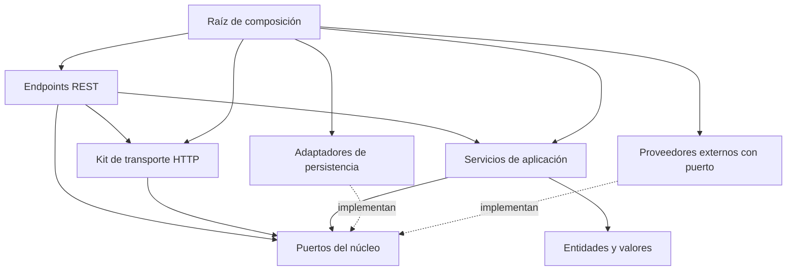

## 1. Infraestructura y Estructura

El servicio sigue una arquitectura hexagonal donde `domain` y `application` definen y consumen contratos, `infrastructure` los implementa o expone, y `src/app.rs` es el único punto que conoce las piezas concretas para conectarlas.

| Ruta o patrón                                                         | Contenido y responsabilidad                                                                                                                        | Límites e integración                                                                                                              |
| --------------------------------------------------------------------- | -------------------------------------------------------------------------------------------------------------------------------------------------- | ---------------------------------------------------------------------------------------------------------------------------------- |
| `src/main.rs`                                                         | Reuniré en `bootstrap()` `envs::init()`, los proveedores criptográficos y tracing; después ejecutaré `app::run()` y cerraré la telemetría.         | Ante un fallo devolveré `ExitCode::FAILURE`; antes de existir tracing solo informaré por stderr.                                   |
| `src/app.rs`                                                          | Construiré en `run`, de arriba abajo, recursos → repositorios → servicios → routers → `ServerOptions`/`ServerLauncher`.                            | Leeré `envs::get()` y entregaré valores por constructor; no trasladaré aquí validaciones ni decisiones de negocio.                 |
| `src/domain/core/{context,error,identity,pagination,values}.rs`       | Definiré contexto de operación, errores de dos capas (`DomainError`), IDs tipados (`DomainId`), identidad (`Actor`, `AuthPrincipal`) y paginación. | No dependeré de entidades ni puertos de negocio; no alojaré drivers, configuración, DTOs ni formateadores de transporte.           |
| `src/domain/entities/<entity>.rs`                                     | Modelaré el agregado, sus tipos de estado o metadatos y su ID tipado `<Entity>Id`.                                                                                                                                         | Sin drivers de base de datos ni detalles del transporte HTTP.                                                                      |
| `src/domain/contracts/{repositories,gateways,system}/`                | Definiré las estructuras de pasarela de datos que cruzan los puertos (criterios de búsqueda `*Criteria`, comandos/acuses de persistencia `*Update`/`*Ack` y modelos neutros de proveedores externos como `CarrierOrder`, `CustomerDetail`, `TaskRequest`). | Sin lógica de transporte HTTP, atributos de motor de BD ni detalles de SDKs externos.                                              |
| `src/domain/port/{repositories,gateways,system}/`                     | Declararé exclusivamente el contrato (`pub trait`) que consume el núcleo (`<Entity>RepositoryPort` o `<Capability>`).                                                                                                      | Sin estructuras de datos acopladas; consumirá las pasarelas de `domain::contracts` y las entidades de `domain::entities`.          |
| `src/application/<capability>.rs`                                     | Coordinaré entidades y puertos; recibiré dependencias explícitas (`Arc<dyn Port>`) por constructor.                                                | Mantendré juntos los métodos cohesionados y dividiré el archivo por responsabilidades, no por un número arbitrario de líneas.      |
| `src/infrastructure/persistence/mongo/<entity>/{model,repository}.rs` | Convertiré entre entidad y documento BSON y ejecutaré consultas; `Repository::new` garantizará sus índices.                                        | Recibiré `&Database` desde `app.rs`, sin importar `providers`.                                                                     |
| `src/infrastructure/providers/`                                       | Prepararé recursos externos: `mongo.rs` (`connect`), `redis.rs` (`RedisProvider`), `gcp/{gcs,gct}.rs` y `auth/`.                                   | Sin entidades ni documentos de negocio; las condiciones de activación están en la sección 4.                                       |
| `src/infrastructure/http/`                                            | Mantendré el kit de transporte Axum: servidor, middlewares, extractores, autenticación HTTP, permisos, paginación, sondas, errores y respuesta.    | No conocerá `application` ni los endpoints; `ServerLauncher` no dependerá de rutas de negocio ni de un estado global de servicios. |
| `src/infrastructure/rest/mod.rs`                                      | Compondré el router de la API, relativo a su prefijo, montando cada recurso con `.nest`.                                                           | Recibiré los servicios concretos; `app.rs` monta la autenticación alrededor cuando esté activa.                                    |
| `src/infrastructure/rest/<resource>/`                                 | Expondré los endpoints de un recurso separando `mod.rs`, `handlers.rs` y `dtos.rs`.                                                                | No moveré al kit `http/` nada que dependa de servicios de aplicación o DTOs de un recurso.                                         |
| `src/shared/`                                                         | Mantendré configuración (`envs.rs`), construcción del cliente HTTP (`http_client.rs`), telemetría y `as_json!` (`tracer.rs`).                      | No alojaré entidades, catálogos de permisos comerciales ni lógica de negocio.                                                      |

- Mantendré la arquitectura en `src/domain/`, `src/application/`, `src/infrastructure/` y `src/shared/`; no introduciré un `src/core/` paralelo ni copiaré el aislamiento por slices de otros proyectos.
- Crearé entidades, puertos, repositorios, modelos y DTOs únicamente cuando la capacidad los necesite:
  - Si un flujo compuesto coordina otros casos de uso sin agregado propio, reutilizaré puertos o servicios existentes sin crear persistencia ficticia.
  - Usaré servicios de dominio solo para lógica pura que no pertenezca a una entidad y no dejaré carpetas vacías como scaffolding.
- Registraré cada capacidad en los módulos de su capa, la construiré en `src/app.rs` y la montaré en `src/infrastructure/rest/mod.rs` si expone HTTP, sin añadir un `AppState` global por recurso.

Cada recurso REST sigue esta anatomía:

```text
src/infrastructure/rest/<resource>/
├── mod.rs        # `pub fn router(service: Arc<Service>) -> Router`: rutas relativas, permisos por método si hay autenticación, y `with_state`
├── handlers.rs   # Handlers `pub(super)`: extraen, invocan el servicio y construyen la respuesta, sin reglas de negocio
└── dtos.rs       # `*Input`/`*Output` y sus mapeos `From`/`TryFrom`, exclusivos del transporte
```

El kit `src/infrastructure/http/` arranca el servidor desde `http/mod.rs` y reexporta ahí toda su superficie pública mientras mantiene privados sus módulos internos:

```text
src/infrastructure/http/
├── mod.rs          # Arranque (ServerOptions, ServerLauncher, capas, bind, señales, drenado, fallbacks 404/405) y fachada pública
├── health.rs       # Único módulo público: health::router(ready) con /healthz y /readyz, y el estado de drenado
├── format.rs       # JSON/MessagePack: BodyFormat, Content-Type de entrada, negociación por Accept, codificación
├── context.rs      # Extractor de Context y ContextRequestExt para middlewares
├── error.rs        # ApiError e IntoResponse con registro único del DomainError
├── response.rs     # ApiResponse, Paginated y paginated()
├── request.rs      # ValidatedBody, PathParam, ValidatedQuery y PaginationQuery
├── middleware.rs   # Trazas W3C/Cloud Trace, timeout y validación de Content-Encoding
└── auth.rs         # Extractor de AuthPrincipal, auth_middleware, Policy y RequirePermissionExt
```

- Reexportaré en `http/mod.rs` únicamente lo que consumen `rest/` y `app.rs`: `ApiError`, `ApiResponse`, `Paginated`, `paginated`, `ValidatedBody`, `ValidatedQuery`, `PathParam`, `PaginationQuery`, `RequirePermissionExt`, `Policy`, `auth_middleware`, `ContextRequestExt`, `ServerLauncher` y `ServerOptions`. `BodyFormat`, el task-local de formato y los middlewares internos no saldrán del kit.
- Mantendré en `format.rs` todo lo que dependa del formato de cable para que `request.rs` y `response.rs` lo consuman sin repetir media types ni serializadores.
- Elegiré el estilo de archivo de cada módulo contando sus hijos directos (archivos o subcarpetas), sin excepciones por capa:
  - Con dos o más hijos, declararé el paquete en `foo/mod.rs` reuniendo declaraciones, reexports y código propio (`http/mod.rs`, `persistence/mongo/mod.rs`, `rest/<resource>/mod.rs`).
  - Con un único hijo, usaré el estilo 2018 `foo.rs` junto a `foo/` (`domain/contracts.rs` con `contracts/system.rs`, `domain/contracts/system.rs` con `contracts/system/task_queue.rs`, `infrastructure/persistence.rs` con `persistence/mongo/`).
  - Sin hijos, usaré un único archivo `foo.rs` (`shared/tracer.rs`, `http/request.rs`).
  - Cuando un módulo cruce el umbral al ganar su segundo hijo o quedarse con uno, migraré su archivo al estilo correspondiente en el mismo cambio sin mezclar ambos estilos.

## 2. Convenciones de Arquitectura, Archivos y Funciones

### 2.1 Artefactos, Archivos y Símbolos

| Artefacto                              | Ruta del archivo                                                 | Símbolo exportado                                                             | Responsabilidad                                                                   |
| -------------------------------------- | ---------------------------------------------------------------- | ----------------------------------------------------------------------------- | --------------------------------------------------------------------------------- |
| Entidad e identificador tipado         | `src/domain/entities/<entity>.rs`                                | `<Entity>`, `<Entity>Id`, `<Entity>Marker`                                    | Estado del agregado con primitivas, structs propios y `chrono::DateTime<Utc>`.    |
| Contrato / pasarela de datos de puerto | `src/domain/contracts/{repositories,gateways,system}/<capability>.rs` | `<Entity>Criteria`, `TaskRequest`, `CarrierOrder`, etc.                       | Estructuras de entrada y salida que viajan por los puertos.                       |
| Puerto de datos de un agregado         | `src/domain/port/repositories/<entity>.rs`                            | Únicamente `trait <Entity>RepositoryPort`                                     | Contrato (`trait`) de persistencia desacoplado del motor de almacenamiento.       |
| Puerto de capacidad técnica o pasarela | `src/domain/port/{gateways,system}/<capability>.rs`                   | Únicamente `trait <Capability>` (`AuthProvider`, `ObjectStorage`, `TaskQueue`) | Contrato (`trait`) de infraestructura técnica sin sufijo `Port`.                  |
| Servicio de aplicación                 | `src/application/<entity>.rs`                                    | `<Entity>Service`                                                             | Casos de uso; nombra sus dependencias `<entity>_repo` (o `repo` si es única).     |
| Modelo de documento/fila               | `src/infrastructure/persistence/<engine>/<entity>/model.rs`      | `<Entity>Model`                                                               | Esquema físico del motor (`ObjectId`, `bson::DateTime`) y mapeo `From`/`TryFrom`. |
| Repositorio persistente                | `src/infrastructure/persistence/<engine>/<entity>/repository.rs` | `<Entity>Repository`                                                          | Consultas del motor e inicialización idempotente de índices en `new`.             |
| DTOs de entrada y salida HTTP          | `src/infrastructure/rest/<resource>/dtos.rs`                     | `Create<Entity>Input`, `Update<Entity>Input`, `<Entity>Output`                | Contratos de transporte HTTP, validaciones y conversión `TryFrom<Entity>`.        |
| Handlers HTTP                          | `src/infrastructure/rest/<resource>/handlers.rs`                 | Funciones `pub(super) async fn`                                               | Extraen `State`, `PathParam<EntityId>`, `ValidatedBody`/`ValidatedQuery`.         |
| Router del recurso                     | `src/infrastructure/rest/<resource>/mod.rs`                      | `pub fn router(service: Arc<<Entity>Service>) -> Router`                      | Rutas relativas (`/`, `/{id}`), permisos por verbo y `.with_state(service)`.      |
| Provider con cliente u operaciones     | `src/infrastructure/providers/**/<vendor>.rs`                    | `<Vendor>Provider` y `<Vendor>Settings`                                       | Cliente técnico o implementación de puerto de capacidad.                          |
| Provider que solo entrega un handle    | `src/infrastructure/providers/<vendor>.rs`                       | `pub async fn connect(...)`                                                   | Configuración y verificación inicial de conexión (`mongo::connect`).              |

### 2.2 Nombres de Funciones por Operación y Capa

| Operación           | `RepositoryPort` y `Repository`                                                           | `<Entity>Service`                                                                    | Handler en `handlers.rs`   | Ruta y verbo HTTP       |
| ------------------- | ----------------------------------------------------------------------------------------- | ------------------------------------------------------------------------------------ | -------------------------- | ----------------------- |
| Crear               | `create(&self, entity: &Entity) -> DomainResult<EntityId>`                                | `create_<entity>(...) -> DomainResult<Entity>`                                       | `create_<entity>`          | `POST /`                |
| Obtener por ID      | `find_by_id(&self, id: &EntityId) -> DomainResult<Option<Entity>>`                        | `get_<entity>(&self, id: &EntityId) -> DomainResult<Entity>`                         | `get_<entity>`             | `GET /{id}`             |
| Listar paginado     | `find_all(&self, pagination: Pagination) -> DomainResult<PageResult<Entity>>`             | `list_<entities>(&self, pagination: Pagination) -> DomainResult<PageResult<Entity>>` | `list_<entities>`          | `GET /`                 |
| Listar por relación | `find_by_<rel>_id(&self, id: &RelId, pagination: Pagination)`                             | `list_<entities>_by_<rel>(&self, id: &RelId, pagination: Pagination)`                | `list_<entities>_by_<rel>` | `GET /<rel>/{<rel>_id}` |
| Actualizar          | `update(&self, id: &EntityId, entity: &Entity, now: DateTime<Utc>) -> DomainResult<bool>` | `update_<entity>(...) -> DomainResult<Entity>`                                       | `update_<entity>`          | `PATCH /{id}`           |
| Actualizar parcial  | `update_<aspect>(&self, id: &EntityId, ..., now: DateTime<Utc>) -> DomainResult<bool>`    | `update_<aspect>(...) -> DomainResult<Entity>`                                       | `update_<aspect>`          | `PATCH /{id}/<aspect>`  |
| Eliminar            | `delete(&self, id: &EntityId) -> DomainResult<bool>`                                      | `delete_<entity>(&self, id: &EntityId) -> DomainResult<()>`                          | `delete_<entity>`          | `DELETE /{id}`          |

- Mantendré inamovible la doble conversión de fronteras: las entidades en `src/domain/entities/` se definen con primitivas, estructuras propias, `DomainId` y `chrono::DateTime<Utc>` (permitiendo `serde` básico cuando sea necesario, sin atributos de motor como `_id`). Al cruzar a persistencia se convierten siempre a `<Entity>Model` (`model.rs`), y al salir hacia el cliente se convierten siempre a `<Entity>Output` (`dtos.rs`), permitiendo cambiar de motor (MongoDB, PostgreSQL, Qdrant) sin tocar `domain` ni `application`.
- Mantendré los nombres de colecciones MongoDB y las rutas HTTP en plural (`/users`, `/products`, `/orders`), y las rutas de recurso relativas a su prefijo usando `{id}`.
- Nombraré todos los índices de MongoDB explícitamente con el sufijo `_idx` (p. ej. `email_unique_idx`, `created_id_compound_idx`) y conservaré compatibles los nombres de campos y variantes persistidos.
- Trataré los enums persistidos como aditivos y mapearé los estados de salida mediante tipos explícitos en `dtos.rs` (`From<Status> for StatusOutput`), nunca mediante `Debug`.
- Usaré `From` únicamente en conversiones infalibles y `TryFrom<...> for ...` con `type Error = DomainError` cuando un ID o un invariante pueda fallar. Al construir DTOs `*Output` de recursos persistidos exigiré que `entity.id` esté presente sin sustituirlo por una cadena vacía ni inventar referencias.
- Extraeré identificadores de ruta directamente como `PathParam<EntityId>` en los handlers y mantendré los `*Input` desacoplados del formato físico de `ObjectId`.
- Preferiré valores propios y `Arc` en fronteras asíncronas, introduciendo lifetimes explícitos solo cuando el contrato lo exija (como deserialización `'de`).

## 3. Ejemplos de Escritura e Integración

Construiré y propagaré errores con `DomainError::new(StatusCode, detail)` desde `crate::domain::core::error`, separando siempre la capa pública (`with_code`, `with_public`) de la capa de desarrollador para tracing (`with_trace_code`, `with_level`, `context`, `chain`):

```rust
use crate::domain::core::error::{DomainError, DomainResult, ResultExt, StatusCode};

let reserved = self.product_repo.try_reserve_stock(pid, quantity, now).await.context("reserving stock")?;
if !reserved {
    return Err(DomainError::new(StatusCode::UNPROCESSABLE_ENTITY, format!("Requested {quantity}, available {}", product.stock))
        .with_code("INSUFFICIENT_STOCK")
        .with_public("Insufficient stock for the requested quantity")
        .with_trace_code("ORDER_STOCK_INSUFFICIENT"));
}
```

Escribiré los handlers en `src/infrastructure/rest/<resource>/handlers.rs` importando extractores y constructores de respuesta únicamente desde la fachada `crate::infrastructure::http`:

```rust
use crate::infrastructure::http::{ApiError, ApiResponse, PathParam, ValidatedBody};

#[tracing::instrument(skip_all)]
pub(super) async fn update_user(
    State(service): State<Arc<DemoUserService>>,
    PathParam(id): PathParam<DemoUserId>,
    ValidatedBody(input): ValidatedBody<UpdateDemoUserInput>,
) -> Result<ApiResponse<DemoUserOutput>, ApiError> {
    let user = service.update_user(&id, &input.name, &input.email).await?;
    Ok(ApiResponse::ok(user.try_into()?))
}
```

Inicializaré los repositorios en paralelo con `tokio::try_join!` y compondré servicios y routers en `src/app.rs`:

```rust
let (users, products, orders) = tokio::try_join!(
    DemoUserRepository::new(&database),
    DemoProductRepository::new(&database),
    DemoOrderRepository::new(&database),
)?;
let users = Arc::new(users);
let api = rest::router(Arc::new(DemoUserService::new(users.clone())), /* ... */);
```

Ejecutaré operaciones comunes y listados paginados en repositorios MongoDB delegando en los helpers tipados (`insert_one`, `find_by_id`, `delete_by_id`, `paginate`) de `src/infrastructure/persistence/mongo/mod.rs`:

```rust
#[tracing::instrument(skip_all)]
async fn find_all(&self, pagination: Pagination) -> DomainResult<PageResult<DemoUser>> {
    paginate(&self.collection, doc! {}, pagination, "DemoUser").await
}
```

## 4. Reglas Generales

Respetaré la dirección de dependencias entre módulos; únicamente `src/main.rs` y `src/app.rs` conocen los adaptadores concretos para ensamblarlos:

| Origen                        | Dependencias permitidas                                                                | Límites                                                                                                |
| ----------------------------- | -------------------------------------------------------------------------------------- | ------------------------------------------------------------------------------------------------------ |
| `domain`                      | `domain`, biblioteca estándar, crates de tipos/serialización, `StatusCode` y `tracing` | No importaré `application`, `shared` ni `infrastructure`; tampoco drivers ni routers Axum.             |
| `application`                 | `domain`, otras capacidades de `application` y utilidades técnicas de `shared`         | No importaré `infrastructure`, DTOs HTTP, modelos BSON ni `envs`. No construiré clientes o conexiones. |
| `infrastructure::persistence` | `domain`, utilidades técnicas de `shared` y su propio árbol                            | No importaré `application`, `infrastructure::{http,rest,providers}` ni `envs`.                         |
| `infrastructure::providers`   | `domain`, utilidades técnicas de `shared` (p. ej. `http_client`) y su propio árbol     | No importaré `application`, `infrastructure::{http,rest,persistence}` ni `envs`.                       |
| `infrastructure::http`        | `domain` y su propio árbol                                                             | No importaré `application`, `infrastructure::{rest,persistence,providers}` ni `shared`.                |
| `infrastructure::rest`        | `domain`, `application` e `infrastructure::http`                                       | No importaré `infrastructure::{persistence,providers}` ni `shared`.                                    |
| `shared`                      | Su propio árbol y crates externos                                                      | No importaré entidades, servicios ni adaptadores del proyecto.                                         |



En el diagrama, `A --> B` significa que A depende de B en código; las prohibiciones son las de la tabla.

### 4.1 Reutilización y Contexto de Operación

- Compartiré una instancia `Arc<dyn Port>` entre los servicios que necesiten ese contrato y un servicio concreto entre varios routers, sin duplicar adaptadores por recurso HTTP.
- Reutilizaré un puerto cuando el caso de uso sea responsable de las reglas que rodean el acceso a datos, y un servicio de aplicación cuando necesite su comportamiento e invariantes. Permitiré dependencias entre servicios de aplicación mientras sean explícitas y acíclicas; ante un ciclo revisaré responsabilidades en lugar de introducir `OnceCell`, locks o inicialización en dos fases.
- Transportaré los datos transversales de una operación (actor, país, tenant) en `Context` (`src/domain/core/context.rs`), que almacena un valor por tipo:
  - Insertaré cada valor en el middleware que lo valida mediante `ContextRequestExt::context()`, o en un worker con `Context::new().with(..)`. Con la autenticación activa, `auth_middleware` inserta el `Actor`. No sobrescribiré un valor en capas inferiores.
  - Recibiré `Context` como extractor en los handlers y lo pasaré como `&Context` únicamente a los métodos de servicio que lean algo de él.
  - Leeré con `require::<T>()` lo obligatorio (su ausencia produce un `500` con `CONTEXT_VALUE_MISSING`, nunca un `4xx`) y con `get::<T>()` lo opcional. Modelaré cualquier primitivo como newtype (`struct TenantId(String)`) y nunca registraré el contenido del contexto en logs.

### 4.2 Manejo de Errores en Dos Capas (`DomainError`)

`DomainError` (`src/domain/core/error.rs`) utiliza un único constructor `DomainError::new(status: StatusCode, detail: impl Into<String>)` y separa estrictamente dos capas:

- Mantendré en la capa pública únicamente `status()`, `code()` (enviado como `cause` en el JSON) y `public_message()` (enviado como `data.message`), que toman por defecto valores genéricos seguros según el `StatusCode`:
  - Personalizaré el mensaje al cliente con `.with_public(..)` en errores de entrada, negocio o recurso no encontrado (`400`, `404`, `409`, `422`), sin incluir jamás valores recibidos, IDs, emails ni datos de terceros.
  - Personalizaré el código público con `.with_code("...")` cuando el cliente necesite distinguir una regla específica.
  - En errores `401`, `403` y `5xx` conservaré el mensaje público genérico por defecto.
- Mantendré en la capa de desarrollador (exclusiva para `tracing`) el código técnico opcional `.with_trace_code("...")` (`error.code`), el nivel `.with_level(tracing::Level)` y el rastro `breadcrumb()` (`error.breadcrumb`), un array JSON ordenado desde el origen más profundo hasta la capa más externa:
  - El argumento `detail` de `DomainError::new` constituye el primer elemento del `breadcrumb`; construiré ese detalle a mano sin volcar mensajes crudos de drivers, SDKs o `reqwest`, credenciales ni datos personales.
  - Añadiré pasos conforme el error sube con `.context("...")` (o `ResultExt::context` sobre `DomainResult`) y combinaré errores previos con `.chain(previous_error)`.
  - Trataré como `StatusCode::INTERNAL_SERVER_ERROR` cualquier fallo en datos construidos por el propio servicio (como un `TaskRequest` inválido).
- Dejaré que `DomainError` se registre automáticamente una sola vez: `ApiError::into_response` invoca `.log()` al responder por HTTP, y `Drop` emite automáticamente cualquier `DomainError` que no haya salido por HTTP ni haya sido absorbido con `.chain(..)`. Usaré `.log()`, `.info()`, `.warn()` o `.error()` cuando quiera forzar la emisión o el nivel explícitamente en trabajo en segundo plano o compensaciones.

### 4.3 Persistencia, Consultas y Tiempo

- Mantendré `None` como ID de una entidad nueva cuando MongoDB deba asignarlo, usando `ObjectId` en el modelo BSON y `DomainId` en el núcleo.
- Crearé los índices de forma idempotente dentro de `Repository::new` y elegiré sus claves según las consultas reales, sin imponer un prefijo universal.
- Aplicaré borrado físico (`delete_one`) por defecto; solo introduciré borrado lógico cuando una política registrada en `PROJECT.md` lo exija para un agregado concreto.
- Traduciré el código `11000` de MongoDB a `StatusCode::CONFLICT` (`MONGO_DUPLICATE_KEY`) en `src/infrastructure/persistence/mongo/error.rs`, sin lecturas previas (_check-then-act_) para comprobar unicidad y sin exponer el valor conflictivo. Mapearé los fallos de conectividad (I/O, DNS, pool, selección de servidor, shutdown) a `StatusCode::SERVICE_UNAVAILABLE` (`MONGO_TRANSIENT_FAILURE`) y el resto a `StatusCode::INTERNAL_SERVER_ERROR` (`MONGO_DRIVER_FAILURE`).
- Actualizaré solo los campos modificables en escrituras y verificaré `matched_count` o `deleted_count` para no devolver éxito cuando el documento no exista.
- Validaré `Pagination::new` (`page >= 1`, `limit` en `1..=100`), ampliando a `u64` antes de multiplicar en `get_skip()` y ordenando con desempate estable (`created_at: -1, _id: -1`).
- Leeré `Utc::now()` una sola vez por operación de escritura en la capa de aplicación y pasaré el instante a los puertos, sin leer el reloj dentro de modelos ni repositorios.

### 4.4 Transporte HTTP, Observabilidad, Configuración y Proveedores

- Devolveré `ApiResponse::ok`, `created`, `paginated` o `empty` según la operación; los errores responderán con `{ trace_id, data: { message }, cause }`, `204` irá sin cuerpo y `/healthz` y `/readyz` devolverán estados HTTP planos (`200` o `503`).
- Mantendré la secuencia de capas de `ServerLauncher`: `trace_context` → compresión → CORS permisivo → negociación JSON/MessagePack (con soporte de pesos `q` y `Vary: Accept`) → `request_timeout` → `content_encoding` → descompresión → `DefaultBodyLimit` → router con fallbacks `404`/`405` (preservando `Allow` en `405`).
- Mantendré `/healthz` independiente de bases de datos y `/readyz` con presupuesto de 2 segundos y verificación de drenado antes y después del `await`.
- Construiré `HttpClient` con 10 segundos de timeout total, 3 segundos de conexión y sin redirecciones automáticas, sanitizando las URLs en errores de middleware.
- Instrumentaré funciones asíncronas con `#[tracing::instrument(skip_all, ...)]` y campos explícitos no sensibles, usando el `trace_id` W3C/Cloud Trace como único identificador de correlación y `as_json!` solo con proyecciones sanitizadas de logging.
- Leeré `envs::get()` únicamente desde `src/main.rs`, `src/app.rs` y `src/shared/`. En `src/shared/envs.rs` declararé solo las variables en uso con `required::<T>`, `or(name, default)` u `optional::<T>`: una variable ausente o vacía toma su default, pero un valor presente inválido hace fallar el arranque sin caer al default.
- Mantendré desconectados por defecto Redis, Cloud Storage, Cloud Tasks y autenticación JWT: no añadiré sus variables a `Env` ni su construcción en `src/app.rs` hasta que una capacidad los consuma. Al activarlos, fallaré el arranque si no pueden inicializarse y nunca degradaré a un modo simulado.

### 4.5 Verificación y Receta de Integración

- Mantendré la plantilla sin suites de pruebas, mocks ni harnesses salvo solicitud explícita del usuario.
- Ejecutaré en orden estos controles al modificar código:
  1. `cargo fmt --all -- --check`
  2. `cargo clippy --locked --all-targets -- -D warnings`
  3. `cargo sort --grouped --check`
  4. `cargo check --locked --all-targets`
  5. `cargo build --locked`
- Revisaré en el diff el cumplimiento de la tabla de dependencias de la sección 4, ya que el compilador no impide imports cruzados dentro del mismo crate, y validaré `docker build --progress=plain -f build/Dockerfile -t rust-hex-template:verify .` cuando modifique el empaquetado.

Para incorporar una capacidad nueva seguiré esta lista verificando cada paso con evidencia:

- [ ] Ubicaré la entidad en `src/domain/entities/`, sus pasarelas en `src/domain/contracts/{repositories,gateways,system}/` y su `trait` en `src/domain/port/{repositories,gateways,system}/`.
- [ ] Implementaré el repositorio en `src/infrastructure/persistence/mongo/<entity>/` o reutilizaré el provider que implemente el puerto.
- [ ] Escribiré el servicio en `src/application/<capability>.rs` recibiendo `Arc<dyn Port>` por constructor.
- [ ] Si expone HTTP, crearé `src/infrastructure/rest/<resource>/{mod,handlers,dtos}.rs` y lo montaré en `src/infrastructure/rest/mod.rs`, declarando permisos por método si requiere autenticación.
- [ ] Conectaré la pieza en `src/app.rs` y añadiré a `src/shared/envs.rs` y `.env.example` únicamente las variables que consuma.
- [ ] Ejecutaré los 5 comandos de verificación y reportaré su resultado diferenciando compilación de validación funcional.

## 5. Reglas Particulares del Proyecto

- Consultaré `PROJECT.md` antes de añadir reglas de negocio o cambiar la postura de seguridad. Mantendré el prefijo `Demo*` exclusivamente en `DemoUser`, `DemoProduct` y `DemoOrder`; no convertiré su uso de `f64` ni la compensación inline de stock en `DemoOrderService::create_order` en política de producción sin acordar antes dinero, idempotencia y consistencia entre escrituras en `PROJECT.md`.
- Cuando active o modifique la autenticación JWT (`src/infrastructure/providers/auth/`), preservaré estos invariantes:
  - Elegiré el perfil de claims en código con `BuildAuthProvider::<X>` (`Auth0Claims`, `HydraClaims`, `HydraMachineToMachineClaims` en `providers/auth/mod.rs`, o un struct propio que implemente `AuthClaims`), sin agregar selectores de proveedor por variable de entorno.
  - En `Auth0Claims` resolveré el cliente con `oauth_cid`, `cid` o `azp` (incluyendo los aliases legacy `https://oauth.99minutos.com/cid` y `permissions`) y el usuario únicamente con `user_id` explícito; nunca usaré `email` ni `sub` como identidad canónica de usuario o cliente.
  - En `HydraClaims` resolveré `client_id` o `ext.client_id` sin convertir `scp` en permisos salvo override explícito, y usaré `HydraMachineToMachineClaims` solo con allowlist de clientes no vacía (`REQUIRES_CLIENT_ALLOWLIST = true`).
  - Mantendré en `JwksVerifier` la verificación obligatoria de RS256, `exp`, `sub`, `nbf` (y de `iss` y `aud` cuando se configuren en `BuildAuthProvider`), rechazo de claves JSON duplicadas (`ClaimDocument`), endpoint JWKS restringido a HTTPS (o HTTP en loopback) sin credenciales/query/fragment, límites de 16 KiB por credencial, 1 MiB y 64 llaves por JWKS, `kid` de 128 bytes y RSA de 2048–4096 bits, así como la caché de 15 minutos con refresco single-flight y cooldown de 30 segundos.
  - Montaré `auth_middleware` por fuera de las capas `RequirePermissionExt` (`require_permission`, `require_any_permission`, `require_all_permissions`), combinando cada verbo HTTP con `.merge(..)` para no contaminar otros métodos de la misma ruta.
- En los proveedores de GCP (`src/infrastructure/providers/gcp/`), usaré el SDK oficial sin features por defecto:
  - En `CloudTasksProvider` autenticaré cada tarea con OIDC (`OidcToken`), rechazaré cabeceras reservadas (`Authorization`, `Host`, `Content-Type`, `Content-Length`, `User-Agent`, `X-Google-*`, `X-AppEngine-*`, `X-CloudTasks-*`) y rutas fuera de `target_url`, y marcaré idempotencia en el SDK únicamente cuando la tarea tenga `id`.
  - Mantendré la familia de OpenTelemetry en `0.32` compatible con `reqwest-tracing`: no habilitaré el tracing nativo de MongoDB ni registraré un segundo `TracerProvider` para absorber el `opentelemetry 0.33` que arrastra internamente el SDK de Google.
